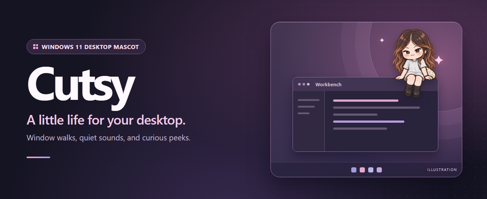

# Cutsy

**A desktop mascot for Windows 11 that walks along window tops, peeks around corners, and reacts when you click her.**

[**Download for Windows**](https://github.com/TobbyTravel/cutsy/releases) · [Make an editable pack](docs/PACK_EDITING.md) · [Roadmap](docs/ROADMAP.md)

## Pick your download

| Edition | How to run it |
| --- | --- |
| **Standalone EXE** | Download and open **Cutsy.exe**. The default pack and .NET runtime are included. |
| **Editable portable ZIP** | Extract the whole ZIP into a writable folder and open **Cutsy.exe** from there. Keep the pack and portable flag beside it to edit recipes and store preferences there. |

The current release is an **unsigned prerelease** for **Windows 11 x64**. The release page includes checksums for both downloads. [Releases](https://github.com/TobbyTravel/cutsy/releases) · [Portable guide](docs/PORTABLE.md)

## Meet Cutsy

- **Click her** for a little reaction, or **drag her** to an exposed window top and watch her perch there. She follows a moving perch and falls to the floor when it disappears.
- **Right-click her or her tray icon** to pause, mute, resize, recover her position, or turn on Gaming mode. She also hides for fullscreen apps and presentations.
- **Open Settings → Pack and preview** to try a recipe or sound. The default pack has 75 sprites, 54 behaviors, and eight short sound effects. Edit the JSON to change timing, reactions, and window interactions. [Pack editing guide](docs/PACK_EDITING.md)

## Build from source

Use the .NET SDK pinned in [global.json](global.json) and PowerShell 7.4 or later on Windows.

~~~powershell
pwsh -File scripts/build.ps1
pwsh -File scripts/test.ps1
pwsh -File scripts/publish.ps1
~~~

Publish writes the standalone EXE, editable ZIP, and SHA-256 checksums to dist. The solution separates the portable behavior engine from the Windows overlay and includes a command-line pack validator. [Architecture](docs/ARCHITECTURE.md) · [Pack format](docs/PACK_FORMAT.md) · [Verification](docs/WALK_AND_WINDOWS_VERIFICATION.md)

## Project information

[Product behavior](docs/PRODUCT.md) · [Artwork and provenance](docs/ASSET_AUDIT.md) · [Testing and release checks](docs/TESTING.md) · [Contributor handoff](docs/IMPLEMENTATION_HANDOFF.md) · [Report an issue](https://github.com/TobbyTravel/cutsy/issues)

The code and bundled artwork currently have no published license.
